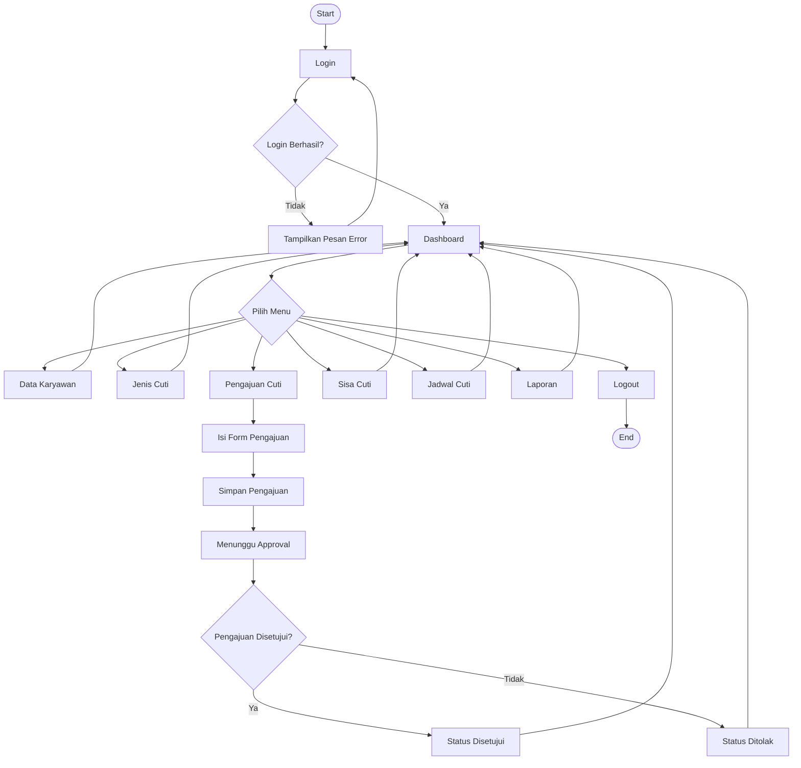
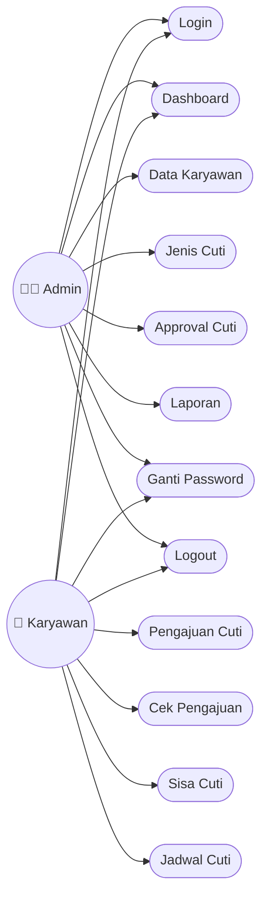

# 💼 SISTEM INFORMASI CUTI KARYAWAN

```txt
============================================================
        💼 SISTEM INFORMASI CUTI KARYAWAN 💼
============================================================

📖 DESKRIPSI
------------------------------------------------------------

Sistem Informasi Cuti Karyawan merupakan aplikasi berbasis
web yang dirancang untuk membantu perusahaan dalam
mengelola seluruh proses administrasi cuti secara digital.
Dengan adanya sistem ini, proses pengajuan cuti yang
sebelumnya dilakukan secara manual dapat dilakukan secara
online sehingga lebih cepat, praktis, dan efisien.

Aplikasi ini memungkinkan setiap karyawan untuk mengajukan
cuti dengan mengisi data yang diperlukan. Selanjutnya,
pengajuan tersebut akan diteruskan kepada atasan atau
administrator untuk dilakukan proses persetujuan. Seluruh
riwayat pengajuan, status cuti, serta data karyawan akan
tersimpan di dalam database sehingga memudahkan pencarian
data dan pembuatan laporan sewaktu-waktu.

============================================================
✨ FITUR APLIKASI
============================================================

🔐 1. LOGIN
------------------------------------------------------------
Pengguna harus melakukan login menggunakan username dan
password yang telah terdaftar. Sistem akan memberikan hak
akses sesuai dengan akun yang digunakan sehingga setiap
pengguna hanya dapat mengakses menu yang diizinkan.

📊 2. DASHBOARD
------------------------------------------------------------
Dashboard menampilkan informasi umum mengenai sistem,
seperti jumlah data karyawan, jumlah pengajuan cuti,
jumlah cuti yang disetujui, ditolak, maupun yang masih
menunggu persetujuan.

👨‍💼 3. DATA KARYAWAN
------------------------------------------------------------
Mengelola seluruh data karyawan, mulai dari menambah,
mengubah, menghapus, hingga melihat informasi lengkap
setiap karyawan.

📁 4. DATA JENIS CUTI
------------------------------------------------------------
Mengelola berbagai jenis cuti yang berlaku di perusahaan,
seperti cuti tahunan, cuti sakit, cuti melahirkan,
dan jenis cuti lainnya.

📝 5. PENGAJUAN CUTI
------------------------------------------------------------
Karyawan dapat mengajukan cuti dengan mengisi formulir
pengajuan yang berisi tanggal cuti, jenis cuti,
serta alasan pengajuan.

✅ 6. APPROVAL CUTI
------------------------------------------------------------
Administrator atau atasan dapat menyetujui maupun
menolak setiap pengajuan cuti yang masuk sesuai dengan
ketentuan perusahaan.

🔎 7. CEK PENGAJUAN CUTI
------------------------------------------------------------
Menampilkan seluruh riwayat pengajuan beserta statusnya,
baik yang sedang diproses, disetujui, maupun ditolak.

📅 8. SISA CUTI
------------------------------------------------------------
Menampilkan informasi jumlah hak cuti yang masih dimiliki
oleh setiap karyawan secara otomatis.

🗓️ 9. JADWAL CUTI
------------------------------------------------------------
Menampilkan jadwal cuti seluruh karyawan sehingga
perusahaan dapat mengatur jadwal kerja dengan lebih baik.

📄 10. LAPORAN
------------------------------------------------------------
Menyediakan laporan data cuti yang dapat dicetak sebagai
dokumen administrasi perusahaan.

🔑 11. GANTI PASSWORD
------------------------------------------------------------
Pengguna dapat mengganti password akun untuk menjaga
keamanan data dan akun yang digunakan.

🚪 12. LOGOUT
------------------------------------------------------------
Mengakhiri sesi login dan keluar dari aplikasi dengan aman.
```

---

# 🔄 Flowchart Sistem



---

# 👥 Use Case Diagram



---

```txt
============================================================
🛠️ TEKNOLOGI YANG DIGUNAKAN
============================================================

💻 PHP Native
🗄️ MySQL Database
🌐 HTML5
🎨 CSS3
⚡ JavaScript
🅱️ Bootstrap
⭐ Font Awesome

============================================================
🎯 MANFAAT SISTEM
============================================================

✔️ Mempermudah proses pengajuan cuti.
✔️ Mengurangi penggunaan dokumen kertas.
✔️ Mempercepat proses persetujuan cuti.
✔️ Memudahkan pencarian data karyawan.
✔️ Menampilkan informasi sisa cuti secara otomatis.
✔️ Menyediakan laporan administrasi yang lebih rapi.
✔️ Mengurangi risiko kehilangan data karena seluruh data
   tersimpan di dalam database.

============================================================
🚀 TUJUAN PENGEMBANGAN
============================================================

Sistem Informasi Cuti Karyawan dikembangkan sebagai solusi
untuk membantu perusahaan dalam mengelola administrasi
cuti secara efektif, efisien, dan terstruktur. Dengan
adanya aplikasi ini diharapkan proses pengelolaan cuti,
penyimpanan data, serta pembuatan laporan dapat dilakukan
dengan lebih mudah dibandingkan menggunakan metode manual.

```